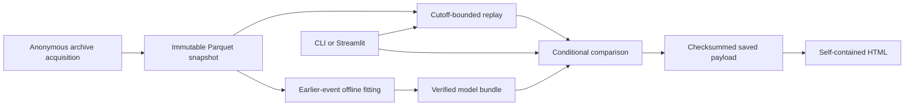

# Architecture and trust boundaries

## Shared core

The installable `f1_strategy` package owns acquisition, immutable snapshots, replay, pace forecasting, conditional simulation and saved analysis. `cli.py` and `app.py` call the same functions; neither recomputes recommendations. `contracts.py` defines frozen validated controls and runtime records; `data/schemas.py` defines Arrow column types. `identity.py` owns canonical JSON, SHA-256 identities, code fingerprints and path confinement.

Source payloads preserve archive JSON bytes, not original receipt-time messages. Prefix views gate release timestamps before aggregation; retrospective audit fields are not forecasting inputs. Immutable snapshot identity covers behavior-affecting metadata, file hashes and versions. Offline replay never fetches the archive.

## Public versus local

Public is the default server mode. Local research requires server-side `F1_STRATEGY_MODE=local`; request/query parameters cannot enable it. Public visitors cannot select filesystem paths, URLs, artifacts, Python callables or training jobs. Only labelled synthetic data and explicitly authorized curated real races are eligible. Operator acquisition and fitting remain CLI workflows.

Authorization applies transitively: focal observations, model fit/tuning/selection/calibration sources and downloaded derivatives each require the applicable scope. Source access, retention, display, report download, model server use and public distribution are separate permissions. A hash authenticates bytes against a manifest, not the legal authority to serve them or the safety of arbitrary pickle. Confidential permission evidence and credentials stay outside snapshots, reports and public assets.

## Artifacts and execution

Serving model bundles use JSON and numeric-only NPZ; no visitor-supplied pickle is accepted. Reports render the complete saved payload and never load a model or query upstream. Snapshot/model members must remain beneath their approved root; absolute members, traversal, symlinks and checksum mismatches fail closed.

The hosted coordinator owns a single heavy subprocess slot and reader leases. The acquisition/comparison worker accepts only its registered bounded protocol; a fixed internal report writer shares the same admission slot. Children use POSIX process groups, private staging, deadlines and bounded captured output. Only the parent may publish a validated, still-authorized completed job. Killing and reaping precede reclamation. Report writes are monitored too. The cache monitor is an application-level bound with possible monitoring overshoot, not an operating-system disk quota.

Exact numerical reproduction requires the recorded lock/backend. Cross-platform retraining comparisons use a numerical tolerance, not an assertion of identical floating-point coefficients. Code identity does not depend on Git: installed Python and rule/event assets are hashed by sorted relative name.

Public snapshot/model admission first inspects verified manifests, including recursive HGB base provenance, before loading tables or numeric arrays. Lock and runtime-library compatibility are enforced; Python 3.12 patch versions remain compatible, while the recorded training patch and platform remain provenance.

Public report downloads transfer authorized bytes directly in the page response as a generated data URI, not a reusable unauthenticated Streamlit `/media` URL. Fixed markup contains only a validated SHA identifier and base64 bytes; race-control text is never injected as unsafe HTML. Authorization is rechecked immediately before transfer. Expiry blocks later server returns; it cannot revoke copies a client already lawfully received. Native [Streamlit downloads](https://docs.streamlit.io/develop/api-reference/widgets/st.download_button) otherwise retain generated media; local research can use that native control.

## External launch prerequisites

This directory began without a Git repository or remote. GitHub CLI access was available through the OS keyring, but the available Streamlit Community Cloud browser session showed **Sign in** and acceptance of Terms was required; no connected deployer consent was exercised. Anonymous archive access does not establish retention or full-lineage public display/model/report/distribution permission. Provider installation and an authorized public real-race browser proof remain unverified.
